

  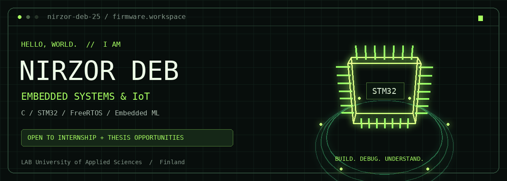

  <a href="https://www.linkedin.com/in/nirzor-deb-opi-635846336/">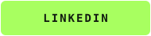</a>
  <a href="mailto:nirzordeb79@gmail.com">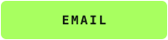</a>
  <a href="https://github.com/nirzor-deb-25?tab=repositories">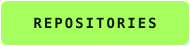</a>

<strong>STM32 firmware · Bare-metal C · Real-time systems · Embedded ML</strong> 
Industrial Information Technology student at LAB University of Applied Sciences, Finland. 
Seeking embedded software internships and thesis opportunities.

<a href="#about">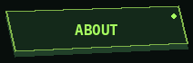</a>
<a href="#tech-stack">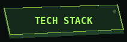</a>
<a href="#selected-projects">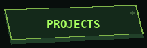</a>
<a href="#learning-goals">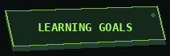</a>
<a href="#opportunities">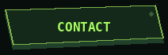</a>

---

<h2>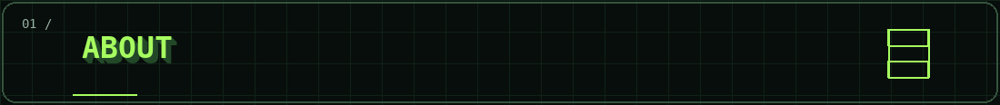</h2>

<table>
<tr>
<td width="35%" align="center" valign="middle">
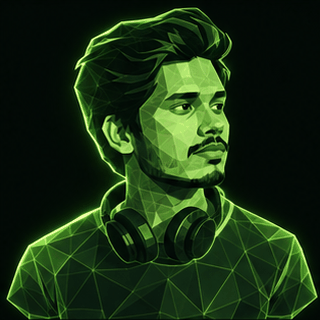 
<strong>NIRZOR DEB</strong> 
Embedded Systems &amp; IoT · Finland
</td>
<td width="65%" valign="middle">

I am an engineering student at <strong>LAB University of Applied Sciences, Finland</strong>, focused on <strong>Embedded Systems and IoT</strong>.

I build practical projects with C and STM32 to understand how firmware, hardware, and sensor data work together.

My portfolio covers bare-metal firmware, memory management, bootloaders, FreeRTOS, and Cortex-M4 debugging. My recent projects connect Python model training with embedded C deployment for motion classification and temperature forecasting.

<strong>Seeking internship and thesis opportunities in Finland.</strong>

</td>
</tr>
</table>

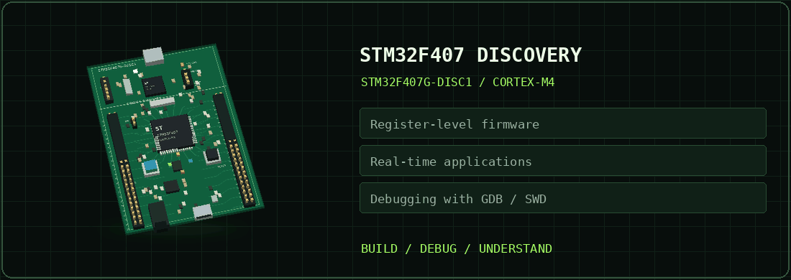

| My focus | Portfolio examples |
| --- | --- |
| Understand the hardware | Direct register access, GPIO, timers, UART, DMA, and SPI sensor interfacing |
| Investigate firmware behavior | GDB/SWD fault investigation, captured exception context, and allocator tests |
| Build toward intelligent devices | Sensor integration, real-time projects, and on-device machine learning |

<h2>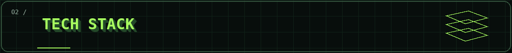</h2>

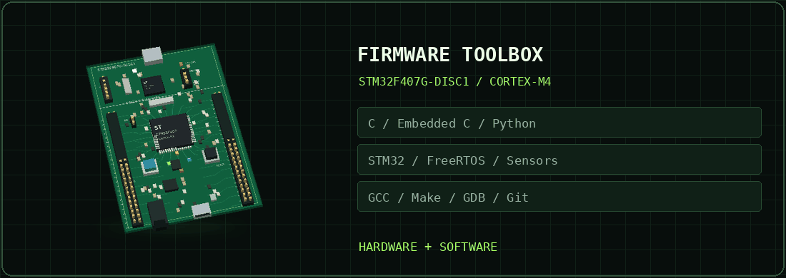

| Category | Hands-on experience |
| --- | --- |
| **Programming** | C, Embedded C, C++ for Arduino; Python for ML training workflows |
| **Microcontroller** | STM32F407 / ARM Cortex-M4; register-level programming without HAL |
| **Peripherals** | GPIO, interrupts, timers/PWM, UART, DMA, SPI sensor interfacing |
| **Real-time firmware** | FreeRTOS projects, producer-consumer patterns, cooperative scheduling |
| **Boot & build** | UART firmware updates, bootloader projects, Makefiles, arm-none-eabi-gcc |
| **Debugging** | ST-LINK, SWD, GDB, Cortex-M4 HardFault investigation |
| **Memory management** | Pool/heap allocators, splitting/coalescing, corruption detection, testing |
| **Embedded ML** | Motion classification, ridge-regression forecasting, on-device verification |
| **Development tools** | STM32CubeIDE, Git, GitHub, Wokwi |

<strong>Hardware available for further projects</strong>

- STM32F407G-DISC1 and NUCLEO-F439ZI.
- ESP32 development boards and Arduino Uno.
- Raspberry Pi 3B+ and Olimex MOD-BME280 sensor module.

<h2>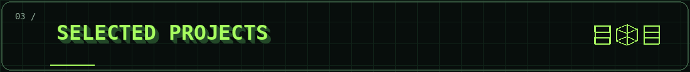</h2>

| Project | Focus | What to explore |
| --- | --- | --- |
| [STM32 MotionSense](https://github.com/nirzor-deb-25/stm32-motionsense) | Bare-metal firmware & embedded ML | Motion classification on STM32, Python training, and deployment verification. |
| [STM32 ThermalPredict](https://github.com/nirzor-deb-25/stm32-thermalpredict) | Sensor data & forecasting | BME280 temperature measurements, ridge regression, and on-device verification. |
| [Memory Allocators in C](https://github.com/nirzor-deb-25/embedded-c-memory-allocator-) | Memory management | Fixed-size pools, heap splitting/coalescing, and a hardened allocator with tests and benchmarks. |
| [STM32 HardFault Debugging](https://github.com/nirzor-deb-25/stm32_hardfault_debug) | Cortex-M4 debugging | GDB/SWD investigation, captured exception context, and a verified alignment-safe fix. |
| [STM32 FreeRTOS Sensor System](https://github.com/nirzor-deb-25/stm32_freertos_sensor_system) | Real-time firmware | A sensor-system project exploring FreeRTOS on STM32. |
| [STM32 Multi-Protocol Sensor Hub](https://github.com/nirzor-deb-25/stm32_multiprotocol_sensor_hub) | Sensor interfaces | A sensor-hub project exploring multiple communication interfaces on STM32. |

<strong>Explore the rest of my firmware projects</strong>

**Drivers, scheduling & firmware updates**

- [SPI LIS3DSH Sensor Interface](https://github.com/nirzor-deb-25/stm32_spi_lis3dsh)
- [FreeRTOS Producer-Consumer](https://github.com/nirzor-deb-25/stm32_freertos_producer_consumer)
- [Cooperative Scheduler](https://github.com/nirzor-deb-25/stm32_cooperative_scheduler)
- [Ground-Up Bootloader](https://github.com/nirzor-deb-25/stm32_groundup_bootloader)
- [UART Bootloader](https://github.com/nirzor-deb-25/stm32_uart_bootloader)

**Bare-metal foundations**

- [Register-Level LED & Button Control](https://github.com/nirzor-deb-25/stm32_register_led_button) — debouncing, single/double clicks, and long-press detection without HAL.
- [Makefile-Based STM32 Project](https://github.com/nirzor-deb-25/stm32_makefile_project) — incremental builds and command-line flashing.
- [DMA UART Echo](https://github.com/nirzor-deb-25/stm32_dma_uart_echo)
- [PWM LED Dimmer](https://github.com/nirzor-deb-25/stm32_pwm_led_dimmer)
- [Smart LED Controller](https://github.com/nirzor-deb-25/stm32_smart_led_controller)
- [STM32 Learning Collection](https://github.com/nirzor-deb-25/stm32-basic-learning) — 11 projects covering C, GPIO, interrupts, volatile, structure packing, bitfields, and keypad input.

**Arduino & IoT**

- [Arduino Projects](https://github.com/nirzor-deb-25/Arduino-Projects-) — Wokwi projects covering sensors, motors, displays, and embedded fundamentals.
- [NFC-Based Attendance System](https://github.com/nirzor-deb-25/NFC-BASED-ATTENDANCE-SYSTEM)

<h2>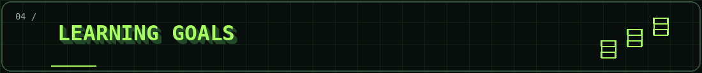</h2>

These are the next areas I want to develop through practical projects.

| Direction | Next project goal |
| --- | --- |
| **Connected devices** | Publish ESP32 sensor measurements over MQTT |
| **Visualization & control** | Create a Node-RED dashboard for remote device control |
| **Embedded Linux** | Cross-compile C applications and explore Raspberry Pi GPIO |
| **Data quality** | Build a room digital twin with sensor noise handling and quality checks |

<h2>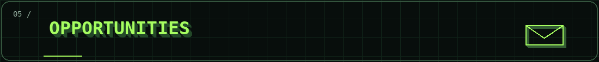</h2>

I am seeking an **embedded software / embedded systems internship or thesis opportunity in Finland**. My interests include embedded C, STM32 firmware, sensor integration, real-time systems, and IoT.

If your team is working in these areas, I would be happy to discuss how I can contribute and learn.

  
  

<a href="mailto:nirzordeb79@gmail.com">nirzordeb79@gmail.com</a> Build. Debug. Understand.

Visual credits

Board animation: a custom 3D reconstruction based on the STM32F407G-DISC1 layout in [STMicroelectronics UM1472](https://www.st.com/resource/en/user_manual/um1472-stm32f4-discovery-stmicroelectronics.pdf). Component placement and geometry are simplified for this portfolio; this is not a manufacturing model.

