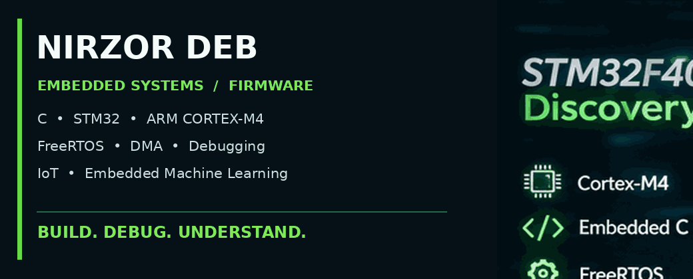
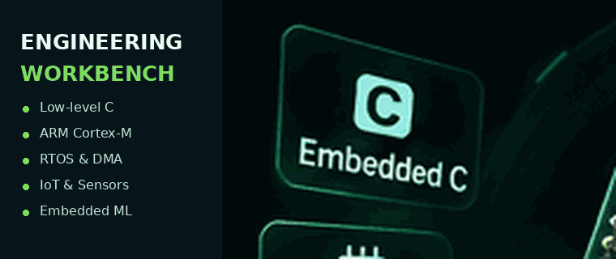

# Nirzor Deb
### Embedded Systems · Firmware Development · IoT · Embedded ML

**Build. Debug. Understand.**

Industrial Information Technology student at **LAB University of Applied Sciences, Finland**  
Interested in **embedded software internships, firmware engineering, and industry-connected bachelor's thesis opportunities**.

[**Portfolio website**](https://nirzor-deb-25.github.io/) · [**GitHub repositories**](https://github.com/nirzor-deb-25?tab=repositories) · [**LinkedIn**](https://www.linkedin.com/in/nirzor-deb-opi-635846336/) · [**Email**](mailto:nirzordeb79@gmail.com)

**C / Embedded C** · **STM32 / ARM Cortex-M4** · **Bare-Metal** · **DMA** · **FreeRTOS** · **GDB / SWD** · **IoT**

---

## About me

I am an engineering student developing a foundation in **hardware-aware software**: embedded C, STM32 peripheral programming, firmware initialization, real-time scheduling, and debugging. My selected projects range from register-level GPIO and DMA transfers to bootloaders, sensor interfaces, and embedded machine-learning prototypes.

I am currently strengthening my understanding by **revisiting implementations, rebuilding key features independently, and improving testing and documentation**. I am particularly interested in low-level firmware, system initialization, power-aware embedded design, and reliable software for connected devices.

> **Current focus:** C proficiency · ARM Cortex-M architecture · DMA / interrupts · firmware debugging · FreeRTOS · system software fundamentals

 Illustrative AI-generated 3D artwork, not a live hardware feed or an accurate PCB CAD model.

## Technical toolkit

| Area | Technologies and topics explored |
| :-- | :-- |
| **Languages** | C, Embedded C; C++ in Arduino projects; Python in ML workflows |
| **Microcontrollers** | STM32F407 / ARM Cortex-M4, ESP32, Arduino |
| **Firmware** | Register-level GPIO, clocks, timers/PWM, UART, DMA, SPI, interrupts, bootloaders |
| **Real-time systems** | FreeRTOS tasks, scheduling and sensor acquisition |
| **Debugging & build** | ST-LINK, SWD, GDB, STM32CubeIDE, GCC, Make, Git |
| **Connected systems** | NFC attendance concepts, sensors, IoT workflows, Wokwi simulations |
| **Embedded intelligence** | Sensor classification, anomaly detection, model-based estimation and forecasting |

## Selected engineering projects — 16

These projects are grouped by engineering discipline. Repository links open the source and available documentation; **simulation results and prototypes are not presented as production-validated hardware**.

### 01 · Embedded C and microcontroller foundations

| Project | Engineering focus |
| :-- | :-- |
| [**Custom Memory Allocator in C**](https://github.com/nirzor-deb-25/embedded-c-memory-allocator-) | Pool allocation, heap management, splitting/coalescing, allocation safety and testing |
| [**Register-Level LED & Button Control**](https://github.com/nirzor-deb-25/stm32_register_led_button) | STM32 GPIO, RCC, memory-mapped registers, button events and debouncing |
| [**PWM LED Dimmer**](https://github.com/nirzor-deb-25/stm32_pwm_led_dimmer) | Hardware timers, prescalers and PWM generation |
| [**DMA UART Echo**](https://github.com/nirzor-deb-25/stm32_dma_uart_echo) | UART peripheral communication, DMA configuration and data buffers |

### 02 · Firmware architecture, drivers and debugging

| Project | Engineering focus |
| :-- | :-- |
| [**UART Firmware Bootloader**](https://github.com/nirzor-deb-25/stm32_uart_bootloader) | Firmware update flow, flash memory, vector tables and application handoff |
| [**SPI LIS3DSH Sensor Driver**](https://github.com/nirzor-deb-25/stm32_spi_lis3dsh) | SPI peripheral transactions and accelerometer interfacing |
| [**Cortex-M4 HardFault Debugging**](https://github.com/nirzor-deb-25/stm32_hardfault_debug) | Exception context, fault investigation and GDB/SWD debugging |
| [**FreeRTOS Sensor System**](https://github.com/nirzor-deb-25/stm32_freertos_sensor_system) | Tasks, sensor sampling and real-time firmware design |

### 03 · IoT and connected systems

| Project | Engineering focus |
| :-- | :-- |
| [**Arduino Projects — Wokwi Simulations**](https://github.com/nirzor-deb-25/Arduino-Projects-) | Simulated sensors, actuators, displays and microcontroller fundamentals |
| [**NFC-Based Attendance System**](https://github.com/nirzor-deb-25/NFC-BASED-ATTENDANCE-SYSTEM) | NFC identification and attendance tracking architecture |
| [**TwinTrust — Sensor Data Quality**](https://github.com/nirzor-deb-25/twintrust-project) | Environmental sensor data checks, filtering and monitoring prototype |

### 04 · Embedded ML, sensing and intelligent power systems

| Project | Engineering focus |
| :-- | :-- |
| [**STM32 MotionSense**](https://github.com/nirzor-deb-25/stm32-motionsense) | Motion classification and embedded inference workflow |
| [**STM32 MachineGuard Lite**](https://github.com/nirzor-deb-25/stm32-machineguard-lite) | Vibration-based anomaly detection prototype |
| [**STM32 ThermalPredict**](https://github.com/nirzor-deb-25/stm32-thermalpredict) | BME280 temperature data, ridge-regression forecasting and on-device verification |
| [**BoostConverterML**](https://github.com/nirzor-deb-25/BoostConverterML) | ML-assisted power-converter analysis using simulated data |
| [**STM32-EV-Climbing-Power-ML**](https://github.com/nirzor-deb-25/STM32-EV-Climbing-Power-ML) | EV climbing-power estimation based on synthetic motion inputs |

**See the project gallery:** [nirzor-deb-25.github.io/projects.html](https://nirzor-deb-25.github.io/projects.html)

## Engineering interests

I am especially interested in engineering teams working on **low-level firmware, embedded C, MCU/SoC initialization, system control, hardware/software interfaces, sensor systems, and embedded reliability**.

My current technical learning priorities are:

1. **C and firmware fundamentals:** pointers, memory safety, bitwise operations and register-level code.
2. **Processor and peripheral architecture:** ARM Cortex-M, interrupts, DMA, clocks and memory maps.
3. **Reliability and debugging:** faults, watchdogs, startup, GDB and evidence-based validation.
4. **Real-time firmware:** FreeRTOS, synchronization and deterministic timing.
5. **Systems expansion:** basic C++, Embedded Linux, networking and power-aware design.

## Learning and certificates

- **Microcontroller Embedded C Programming: Absolute Beginners** — FastBit / Udemy, completed October 2026. [Credential](https://www.udemy.com/certificate/UC-1978d36f-352e-4168-b795-cf2526598547/)
- **Free Embedded Systems Course** — Simplilearn SkillUp, completed October 2026.

I complement coursework with practical experiments, datasheets, reference manuals, project documentation and code-review exercises.

## Opportunities and contact

I am interested in **embedded systems / firmware internships** and **company-supervised bachelor's thesis opportunities in Finland**. I would welcome conversations about junior-level work involving embedded C, STM32, debugging, sensors, real-time software, and industrial IoT.

[**Portfolio**](https://nirzor-deb-25.github.io/) · [**Projects**](https://github.com/nirzor-deb-25?tab=repositories) · [**LinkedIn**](https://www.linkedin.com/in/nirzor-deb-opi-635846336/) · **[Email me](mailto:nirzordeb79@gmail.com)**

Build. Debug. Understand.

<strong>Visual notes and accessibility</strong>

The two animated hardware visuals are AI-generated conceptual illustrations inspired by STM32 development boards, not CAD representations, device captures, or performance evidence. They are included as local GIF assets for GitHub README compatibility. Motion-sensitive visitors can disable animated image playback using browser or system accessibility controls. [STM32F4 Discovery user manual (STMicroelectronics)](https://www.st.com/resource/en/user_manual/um1472-stm32f4-discovery-stmicroelectronics.pdf).

