

  

  
  
  

<strong>Embedded C · STM32 Firmware · ARM Cortex-M · FreeRTOS · IoT · Embedded ML</strong> 
Industrial Information Technology student at LAB University of Applied Sciences, Finland. 
Open to embedded software internships and industry-connected thesis opportunities in Finland.

<a href="#about">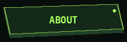</a>

<a href="#selected-projects">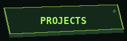</a>

<a href="#opportunities">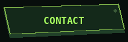</a>

<a href="#certificates-and-training">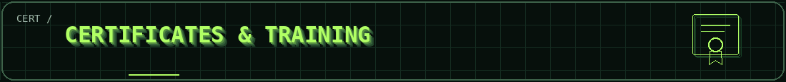</a>

---

<h2>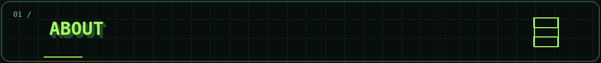</h2>

<table>
<tr>
<td width="35%" align="center" valign="middle">
 
<strong>NIRZOR DEB</strong> 
Embedded Systems &amp; IoT · Finland
</td>
<td width="65%" valign="middle">

I am an engineering student at <strong>LAB University of Applied Sciences, Finland</strong>, focused on <strong>Embedded Systems and IoT</strong>.

My focus is on <strong>low-level embedded software</strong>: programming microcontrollers, working with hardware peripherals, and understanding how systems behave under real-world constraints.

My selected projects span <strong>register-level STM32 development, DMA, firmware bootloaders, Cortex-M4 fault debugging, FreeRTOS, sensor interfaces, IoT prototypes, and embedded machine learning</strong>. I am strengthening my ability to independently explain, test, and debug the engineering decisions behind each implementation.

<strong>Seeking internship and thesis opportunities in Finland.</strong>

</td>
</tr>
</table>

| My focus | Portfolio examples |
| --- | --- |
| Understand the hardware | Direct register access, GPIO, timers, UART, DMA, and SPI sensor interfacing |
| Investigate firmware behavior | GDB/SWD fault investigation, captured exception context, and allocator tests |
| Develop connected and intelligent devices | NFC attendance, TwinTrust sensor-data validation, and STM32 machine-learning experiments |

<h2>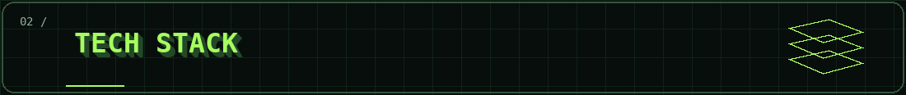</h2>

| Category | Hands-on experience |
| --- | --- |
| **Programming** | C, Embedded C, C++ for Arduino; Python for ML training workflows |
| **Microcontroller** | STM32F407 / ARM Cortex-M4; register-level programming without HAL |
| **Peripherals** | GPIO, interrupts, timers/PWM, UART, DMA, SPI sensor interfacing |
| **Real-time firmware** | FreeRTOS sensor tasks, queues and scheduling concepts |
| **Boot & build** | UART firmware updates, bootloader projects, Makefiles, arm-none-eabi-gcc |
| **Debugging** | ST-LINK, SWD, GDB, Cortex-M4 HardFault investigation |
| **Memory management** | Pool/heap allocators, splitting/coalescing, corruption detection, testing |
| **Embedded ML & modeling** | Motion classification, anomaly detection, regression-based prediction, and power-system simulation projects |
| **Development tools** | STM32CubeIDE, GCC/Make, Git, GitHub, GDB, ST-LINK, Wokwi |

<strong>Hardware available for further projects</strong>

- STM32F407G-DISC1 and NUCLEO-F439ZI.
- ESP32 development boards and Arduino Uno.
- Raspberry Pi 3B+ and Olimex MOD-BME280 sensor module.

<h2>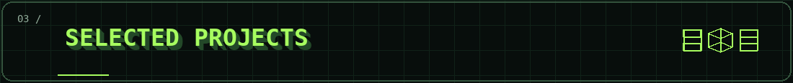</h2>

A curated collection of **16 engineering projects**. The project names below are clickable 3D-style buttons that open the repositories directly.

### Low-Level C & STM32 Fundamentals

<table>
<tr><th align="left">Project</th><th align="left">Engineering focus</th></tr>
<tr>
<td></td>
<td>Memory pools, heap allocation, splitting/coalescing, and defensive memory management.</td>
</tr>
<tr>
<td></td>
<td>STM32 GPIO/RCC register configuration, button debouncing, and event handling without HAL.</td>
</tr>
<tr>
<td></td>
<td>Hardware timers, prescalers, PWM output, and duty-cycle control.</td>
</tr>
<tr>
<td></td>
<td>UART data transfers using DMA, buffer handling, and interrupt-driven firmware concepts.</td>
</tr>
</table>

### Firmware Architecture, Drivers & Debugging

<table>
<tr><th align="left">Project</th><th align="left">Engineering focus</th></tr>
<tr>
<td></td>
<td>Firmware loading over UART, flash programming, memory maps, and application startup.</td>
</tr>
<tr>
<td></td>
<td>STM32 SPI peripheral communication and accelerometer register access.</td>
</tr>
<tr>
<td></td>
<td>Exception-context investigation, GDB/SWD debugging, and a documented alignment-safe fix.</td>
</tr>
<tr>
<td></td>
<td>Sensor acquisition, real-time task organization, and FreeRTOS scheduling.</td>
</tr>
</table>

### Connected Devices & IoT

<table>
<tr><th align="left">Project</th><th align="left">Engineering focus</th></tr>
<tr>
<td><a href="https://github.com/nirzor-deb-25/Arduino-Projects-">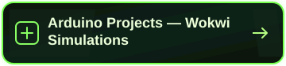</a></td>
<td>Simulated circuits and microcontroller exercises using sensors, motors, and displays.</td>
</tr>
<tr>
<td></td>
<td>NFC-based student identification and attendance-recording system design.</td>
</tr>
<tr>
<td></td>
<td>Sensor-data quality checks and monitoring workflows for more trustworthy readings.</td>
</tr>
</table>

### Embedded Machine Learning & Intelligent Power Systems

<table>
<tr><th align="left">Project</th><th align="left">Engineering focus</th></tr>
<tr>
<td></td>
<td>Motion classification with STM32 firmware, Python-based training, and deployment verification.</td>
</tr>
<tr>
<td></td>
<td>Sensor/vibration anomaly-detection prototype on STM32.</td>
</tr>
<tr>
<td></td>
<td>BME280 temperature measurements, ridge-regression forecasting, and embedded verification.</td>
</tr>
<tr>
<td></td>
<td>Simulated boost-converter data and machine-learning-assisted estimation experiments.</td>
</tr>
<tr>
<td></td>
<td>Electric-vehicle climbing-power estimation using modeled conditions and synthetic acceleration inputs.</td>
</tr>
</table>

> **Engineering approach:** I use development tools, documentation, and AI-assisted guidance where helpful, then work toward validating behavior, understanding the code, and rebuilding important features independently. Hardware tests, simulations, and model-based results should be interpreted according to the evidence in each repository.

<h2></h2>

Completed courses supporting my practical work in embedded C and embedded systems.

| Course | Provider | Completed | Certificate |
| --- | --- | --- | --- |
| **Microcontroller Embedded C Programming: Absolute Beginners** | Udemy · FastBit Embedded Brain Academy / Kiran Nayak | 23 October 2026 · 16.5 hours | [View credential](https://www.udemy.com/certificate/UC-1978d36f-352e-4168-b795-cf2526598547/) · [PDF](./udemy-embedded-c.pdf) |
| **Free Embedded Systems Course** | Simplilearn SkillUp | 23 October 2026 | [PDF](./simplilearn-embedded-systems.pdf) · Certificate code: 10930187 |

<strong>Preview my certificates</strong>

### Microcontroller Embedded C Programming: Absolute Beginners

<a href="./udemy-embedded-c.pdf">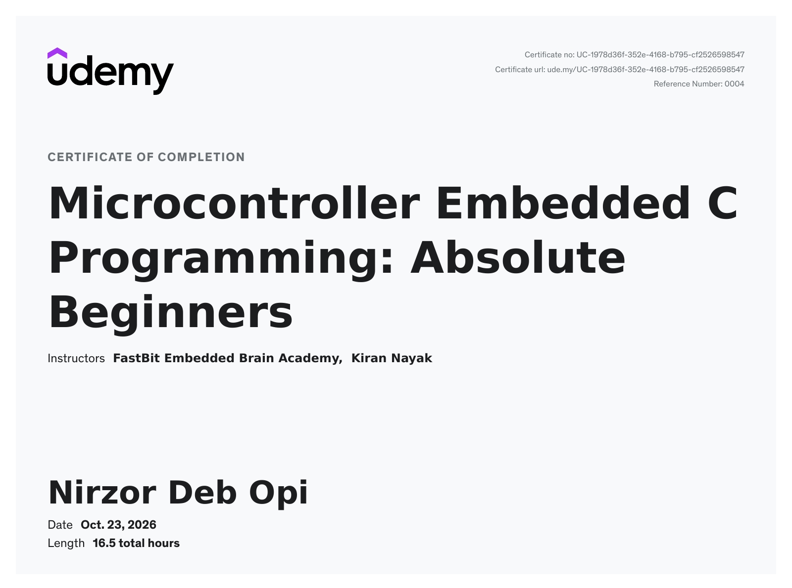</a>

Credential ID: `UC-1978d36f-352e-4168-b795-cf2526598547`

### Free Embedded Systems Course

<a href="./simplilearn-embedded-systems.pdf">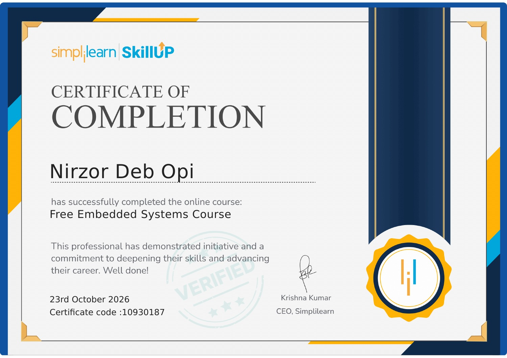</a>

Certificate code: `10930187`

<h2>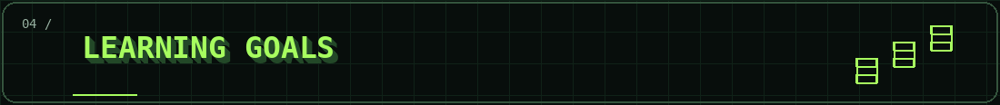</h2>

My next learning priorities build on the projects above, with an emphasis on deeper independent implementation and system-level understanding.

| Direction | Next project goal |
| --- | --- |
| **Connected devices** | Publish ESP32 sensor measurements over MQTT |
| **Visualization & control** | Create a Node-RED dashboard for remote device control |
| **Embedded Linux** | Cross-compile C applications and explore Raspberry Pi GPIO |
| **Firmware reliability** | Practice fault handling, validation, and repeatable tests for STM32 peripherals and startup code |

<h2></h2>

I am seeking an **embedded software / embedded systems internship or thesis opportunity in Finland**. My interests include embedded C, ARM Cortex-M, firmware debugging, device drivers, real-time systems, and connected devices.

If your team is working in these areas, I would be happy to discuss how I can contribute and learn.

  
  

<a href="mailto:nirzordeb79@gmail.com">nirzordeb79@gmail.com</a> Build. Debug. Understand.

Visual credits

Board animation: an AI-generated 3D product visualization based on the STM32F407 Discovery reference in [STMicroelectronics UM1472](https://www.st.com/resource/en/user_manual/um1472-stm32f4-discovery-stmicroelectronics.pdf). This is a portfolio illustration, not an exact CAD model or a technical component-placement reference.

